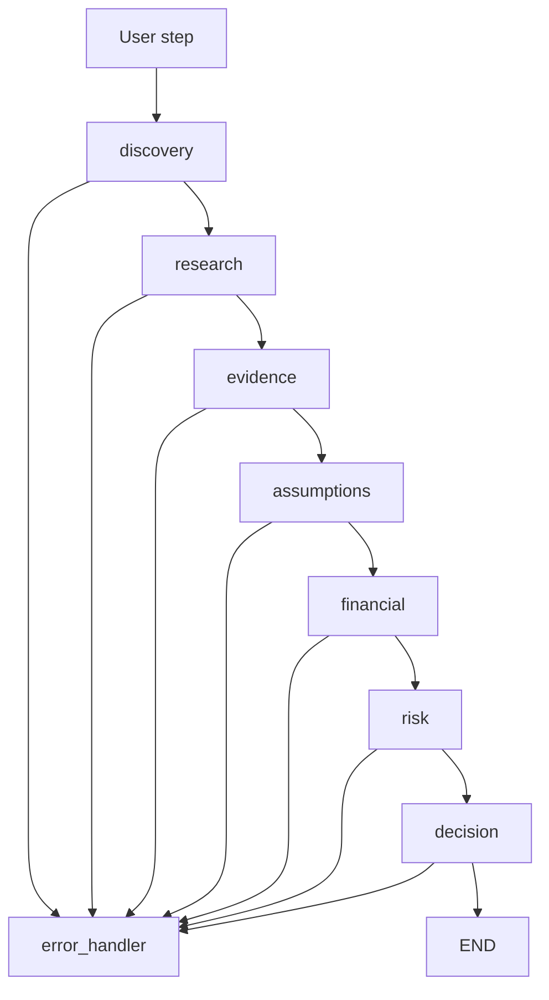
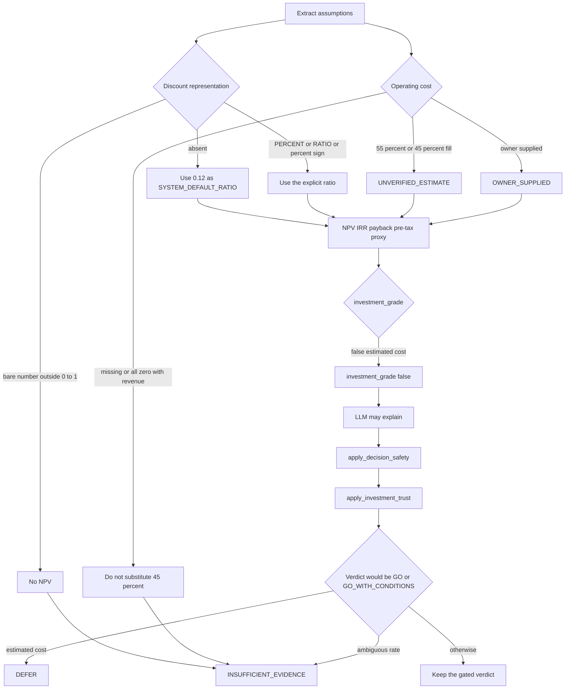
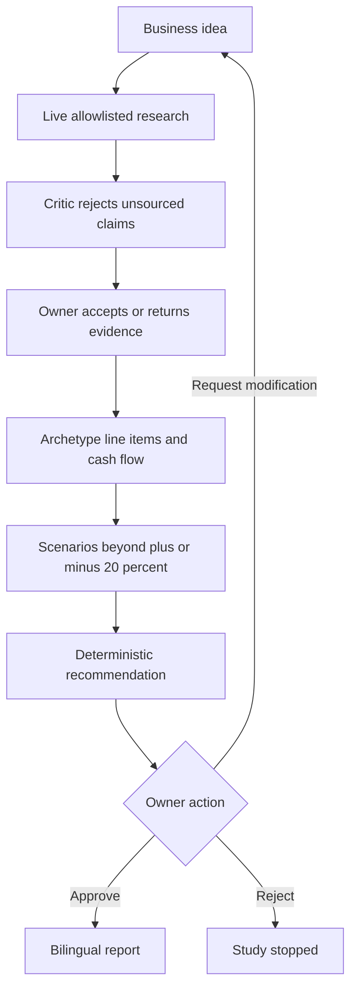

# Flowcharts

Implemented diagrams describe `recovery/financial-trust-20261028`. Proposed diagrams are not built.

## Implemented study graph

Each user step runs one phase and then ends. `EVIDENCE_REVIEW` routes back through research before evidence.

## Implemented recommendation ceiling

`NO_GO` is not replaced. `INSUFFICIENT_EVIDENCE` replaces `DEFER` when the discount rate is ambiguous.

## Proposed owner journey

This journey is proposed. Live Monsha'at and web search are not part of the implemented graph.
