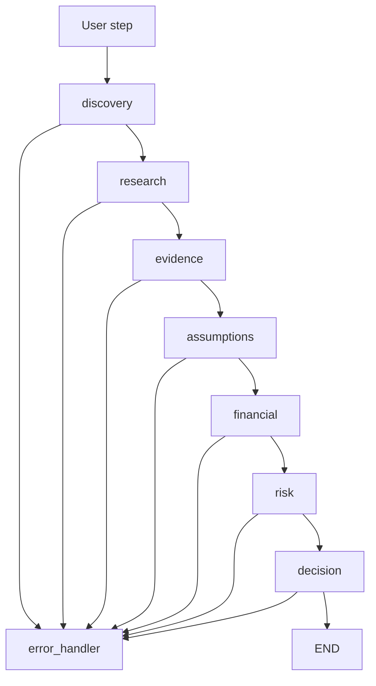
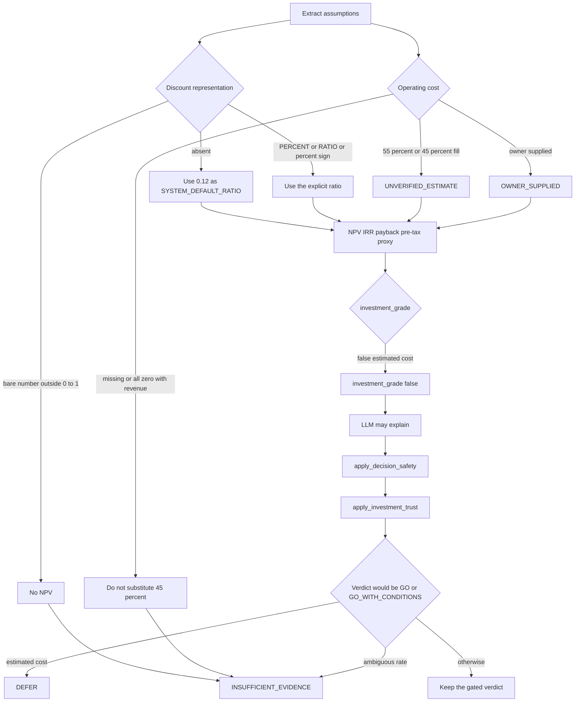
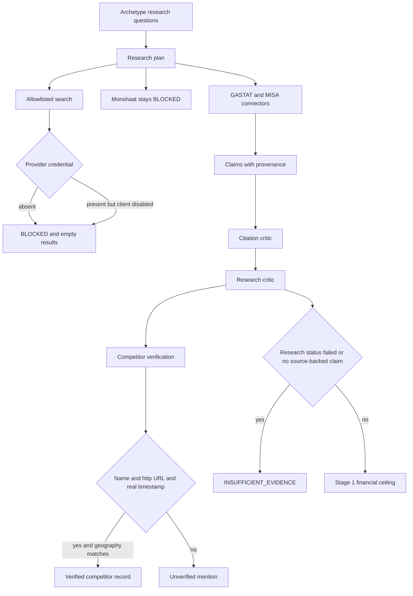
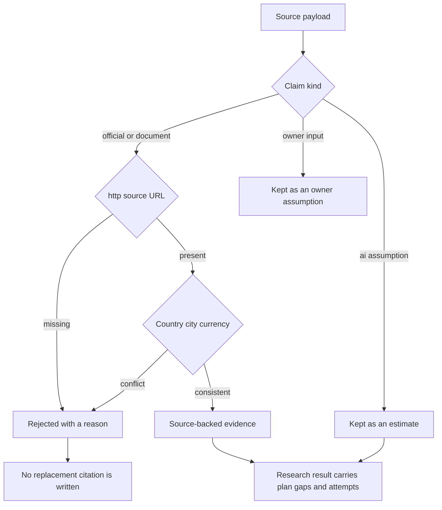
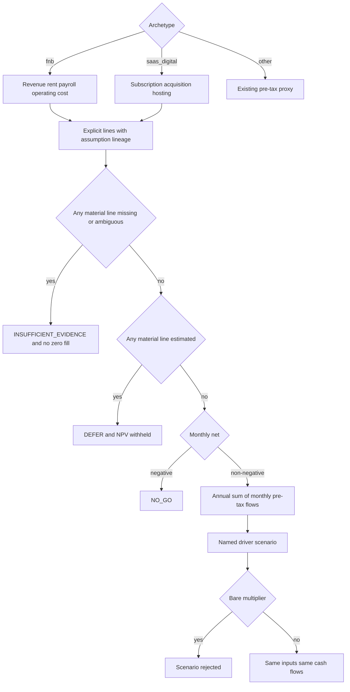
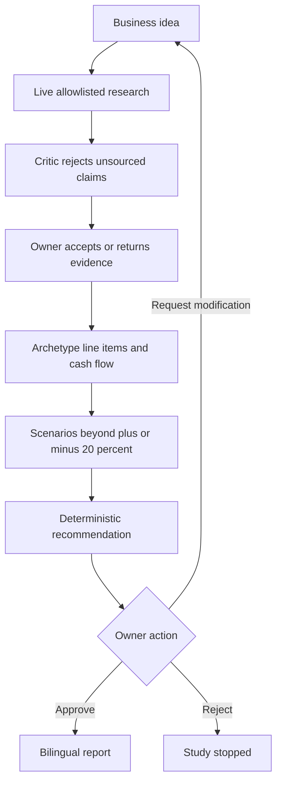

# Flowcharts

Implemented diagrams describe `saudi-business-completion`. The financial ceiling shipped on `8f9eac6`. The research ceiling below is the Stage 2 behavior.

## Implemented study graph

Each user step runs one phase and then ends. `EVIDENCE_REVIEW` routes back through research before evidence.

## Implemented recommendation ceiling

`NO_GO` is not replaced. `INSUFFICIENT_EVIDENCE` replaces `DEFER` when the discount rate is ambiguous.

## Implemented research and competitor contract

A verified competitor record stores publisher, identity, stated location, retrieval time, and the supporting claim separately. Missing URL and timestamp fields are left empty.

## Implemented evidence provenance

Provider errors append to the research error list and keep the run out of `complete`.

## Implemented coffee and SaaS projection

The cash-flow basis is `PRE_TAX_OPERATING_PROJECTION`. VAT and Zakat are not in the series. The study workspace renders these lines, their lineage, and a stale banner after an assumption edit. A favorable verdict does not survive that edit.

## Proposed owner journey

This journey is proposed. Live Monsha'at and web search are not part of the implemented graph.
